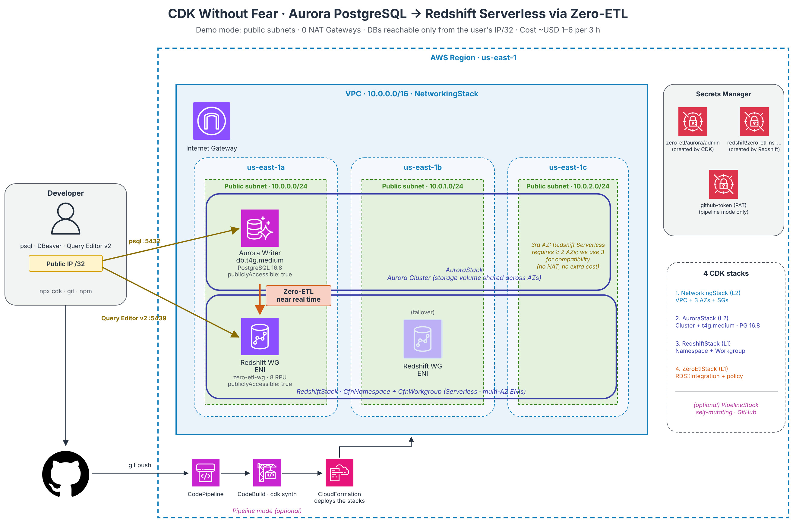

# Lab: Aurora PostgreSQL → Redshift Serverless with Zero-ETL using AWS CDK

🇪🇸 [Léelo en español](LAB.md)

This guide takes you from zero to Aurora PostgreSQL replicating data into Redshift Serverless in near real time, with a single `npx cdk deploy`. It works on macOS, Linux and Windows (with WSL2). Every step ends with a check so you know you can move on.

> 📖 Want to understand the concepts first (Zero-ETL, L1/L2/L3 constructs, the traps the code solves)? The English article **"CDK Without Fear"** is 🚧 coming soon. In the meantime, the [Spanish version is on Medium](https://medium.com/@carlosgaonad/cdk-sin-miedo-de-aurora-postgresql-a-redshift-serverless-con-zero-etl-e9d8cea17806).



| | |
|---|---|
| Time | 1.5 to 2 hours (the deployment takes about 15–20 min) |
| Estimated cost | USD 1 to 6 if you delete everything the same day |
| Operating systems | macOS, Linux or Windows (with WSL2) |
| Level | 200 (intermediate): you can code and use a terminal |

## Contents

- [Before you start: your account and the costs](#before-you-start-your-account-and-the-costs)
- [Step 0: pick your terminal](#step-0-pick-your-terminal)
- [Step 1: install the tools](#step-1-install-the-tools)
- [Step 2: connect your terminal to your AWS account](#step-2-connect-your-terminal-to-your-aws-account)
- [Step 3: clone the project and install dependencies](#step-3-clone-the-project-and-install-dependencies)
- [Step 4: test and synthesize (without touching your account)](#step-4-test-and-synthesize-without-touching-your-account)
- [Step 5: prepare your account for CDK (bootstrap)](#step-5-prepare-your-account-for-cdk-bootstrap)
- [Step 6: save your public IP](#step-6-save-your-public-ip)
- [Step 7: review and deploy](#step-7-review-and-deploy)
- [Step 8: confirm the integration is active](#step-8-confirm-the-integration-is-active)
- [Step 9: create tables and data in Aurora](#step-9-create-tables-and-data-in-aurora)
- [Step 10: activate the integration in Redshift](#step-10-activate-the-integration-in-redshift)
- [Step 11: query and test live replication](#step-11-query-and-test-live-replication)
- [Step 12 (optional): what would production look like?](#step-12-optional-what-would-production-look-like)
- [Cleanup: delete everything when you finish](#cleanup-delete-everything-when-you-finish)
- [Troubleshooting](#troubleshooting)
- [Bonus: automatic deployment on every `git push`](#bonus-automatic-deployment-on-every-git-push)

---

## Before you start: your account and the costs

Aurora and Redshift are **not in the free tier** and start billing from the first minute. The lab is cheap if you delete it the same day, but it's worth knowing how much and protecting yourself.

### Your AWS account needs the "Paid" plan

Since July 2025, new accounts choose between a **Free** plan and a **Paid** plan. The Free plan only gives access to some services and **does not include Redshift**: if you try, you'll get an error like `SubscriptionRequiredException`.

- If your account is on the Free plan, upgrade it to Paid from the console. Any unused welcome credits are kept.
- If you have never used Redshift Serverless, you may be eligible for a [USD 300 trial credit](https://aws.amazon.com/redshift/free-trial/) valid for 90 days.
- Don't use the *root* user for the lab. In step 2 we create a user just for this.

### How much it costs

Approximate prices in `us-east-1`; check your region on the [Aurora](https://aws.amazon.com/rds/aurora/pricing/) and [Redshift](https://aws.amazon.com/redshift/pricing/) pricing pages.

| Resource | Price | 3-hour lab |
|---|---|---|
| Aurora `db.t4g.medium` (1 instance) | ~USD 0.073/hour | ~USD 0.22 |
| Aurora storage and I/O | Cents for this data | < USD 0.05 |
| Redshift Serverless (8 base RPUs) | USD 0.375 per RPU-hour = USD 3 per **active** hour | USD 0.50 to 5 |
| Secrets Manager (2 secrets) | USD 0.40/month each, prorated | < USD 0.01 |
| VPC, subnets, internet gateway | Free | USD 0 |
| NAT Gateway | Not created in demo mode | USD 0 |

**Estimated total: USD 1 to 6**, depending on how much Redshift works. Redshift bills per second (60-second minimum) when it runs your queries **and also when it processes the changes arriving through Zero-ETL**, so with the integration active it doesn't stay at zero.

> ⚠️ If you forget to delete everything, the meter keeps running: Aurora alone adds up to ~USD 1.75 per day, plus Redshift compute. That's why [cleanup](#cleanup-delete-everything-when-you-finish) is part of the lab, not an extra.

### Create a budget alert (5 minutes)

1. In the console, go to **Billing and Cost Management → Budgets → Create budget**.
2. Choose the **Monthly cost budget** template.
3. Set an amount, for example **USD 10**, and your email.
4. Create the budget. AWS will warn you if actual or forecasted spend exceeds it.

### Region

The lab is designed for **us-east-1 (N. Virginia)**. Aurora PostgreSQL Zero-ETL is available in every commercial region where Redshift exists, so you can use another one; just change the region in step 2 and in the cleanup commands.

---

## Step 0: pick your terminal

- **macOS:** the Terminal app.
- **Linux:** your usual terminal. Commands assume Ubuntu/Debian.
- **Windows:** use **WSL2** with Ubuntu. All lab commands are Bash, so they work exactly as on Linux. Open PowerShell as administrator, run the following and restart:

```powershell
wsl --install
```

After restarting, open the **Ubuntu** app and create your user. From here on, follow the Linux instructions inside that window.

## Step 1: install the tools

You need four things: **Node.js**, **Git**, **AWS CLI v2** and a **PostgreSQL client** (`psql`). `jq` is optional but helps read JSON.

**Node.js:** install LTS version **22**. It's the one supported by the CDK version pinned in the project. Newer versions (for example, 25) work, but every command shows a `This software has not been tested with node` warning box. The easiest way is [nvm](https://github.com/nvm-sh/nvm): `nvm install 22 && nvm use 22`. The repo includes an `.nvmrc` file, so inside the folder `nvm use` is enough. You can also use the installer from [nodejs.org/en/download](https://nodejs.org/en/download), choosing version 22.

**macOS** (with [Homebrew](https://brew.sh)):

```bash
brew install git awscli libpq jq
brew link --force libpq   # makes the psql command available
```

**Linux / WSL2 (Ubuntu):**

```bash
sudo apt update && sudo apt install -y git unzip jq postgresql-client

# AWS CLI v2 (official installer; on ARM machines replace x86_64 with aarch64)
curl "https://awscli.amazonaws.com/awscli-exe-linux-x86_64.zip" -o awscliv2.zip
unzip -q awscliv2.zip && sudo ./aws/install && rm -rf aws awscliv2.zip
```

> Prefer a graphical tool instead of `psql`? [DBeaver Community](https://dbeaver.io) is free and runs on all three systems. See the alternative in step 9.

**Check:**

```bash
node --version   # v22.x
git --version
aws --version    # aws-cli/2.x
psql --version
```

## Step 2: connect your terminal to your AWS account

We'll create a user just for the lab and give it access keys. When you finish the lab, you delete the keys.

1. In the AWS console, go to **IAM → Users → Create user**.
2. Name: `cdk-lab`. It doesn't need console access.
3. Under permissions, choose **Attach policies directly** and select `AdministratorAccess`. (It's broad, but CDK creates roles, networks and databases. Use it only for this lab.)
4. Open the new user → **Security credentials** tab → **Create access key** → **Command Line Interface (CLI)** option.
5. Copy the *Access key ID* and the *Secret access key*. The secret is shown only once.

Then, in your terminal:

```bash
aws configure
# AWS Access Key ID:     <paste the Access key ID>
# AWS Secret Access Key: <paste the Secret access key>
# Default region name:   us-east-1
# Default output format: json
```

If your organization uses IAM Identity Center (SSO), use `aws configure sso` instead of keys.

**Check:**

```bash
aws sts get-caller-identity
```

You should see your account number (`Account`) and the ARN of the `cdk-lab` user.

## Step 3: clone the project and install dependencies

```bash
git clone https://github.com/carlosgaonad/cdk-zero-etl-pipeline.git
cd cdk-zero-etl-pipeline
nvm use        # if you use nvm: picks the version from .nvmrc
npm ci
```

`npm ci` installs exactly the versions in `package-lock.json`, including CDK's. You can ignore *deprecated* package warnings.

**Check:**

```bash
npx cdk --version   # 2.170.0
```

> Always use `npx cdk` (not a global `cdk`) so you work with the CDK version pinned in the project.

## Step 4: test and synthesize (without touching your account)

Before creating anything in AWS, run the tests and generate the templates:

```bash
npm test
npx cdk ls
```

You should see `Tests: 25 passed` and the four stacks:

```text
CdkZeroEtl/NetworkingStack (CdkZeroEtl-NetworkingStack)
CdkZeroEtl/AuroraStack (CdkZeroEtl-AuroraStack)
CdkZeroEtl/RedshiftStack (CdkZeroEtl-RedshiftStack)
CdkZeroEtl/ZeroEtlStack (CdkZeroEtl-ZeroEtlStack)
```

Now look at what CDK will ask CloudFormation for:

```bash
npx cdk synth CdkZeroEtl/AuroraStack
ls cdk.out/assembly-CdkZeroEtl/
```

Open any `*.template.json` in your editor and search for `rds.logical_replication`. That JSON is what you used to write by hand.

> If you see `current credentials could not be used to assume '...cdk-hnb659fds-lookup-role...'. Proceeding anyway`, that's expected before bootstrapping: step 5 creates that role.

## Step 5: prepare your account for CDK (bootstrap)

This is done only once per account and region:

```bash
npx cdk bootstrap
```

It takes 2–3 minutes and ends with `Environment aws://<your-account>/us-east-1 bootstrapped`.

## Step 6: save your public IP

The security groups will only accept connections from your IP:

```bash
export MY_IP="$(curl -s https://checkip.amazonaws.com)/32"
echo $MY_IP   # example: 190.25.10.4/32
```

> If you close the terminal, run the `export` again. If your IP changes (different Wi-Fi, VPN), repeat this step and step 7.

If you work in native PowerShell rather than WSL2, the equivalent is:

```powershell
$env:MY_IP = "$((Invoke-RestMethod https://checkip.amazonaws.com).Trim())/32"
```

## Step 7: review and deploy

First, see what will be created:

```bash
npx cdk diff --all -c myIp=$MY_IP
```

You'll see a list of resources marked `[+]` and a table of security changes (IAM roles and network rules). Reviewing it before deploying is a good habit.

Now deploy the four stacks:

```bash
npx cdk deploy --all -c myIp=$MY_IP --require-approval never
```

`--require-approval never` stops CDK from asking "do you wish to deploy?" for every stack with security changes; you already reviewed them with `diff`.

It takes **15 to 20 minutes**; Aurora is the slowest part. Meanwhile, open **CloudFormation** in the console and watch the `CdkZeroEtl-*` stacks and their resources appear.

**Check:** the terminal ends with a ✅ for each stack and prints the *Outputs*, such as `ClusterEndpoint`, `WorkgroupEndpoint` and `IntegrationArn`.

## Step 8: confirm the integration is active

```bash
aws rds describe-integrations \
  --query "Integrations[].[IntegrationName,Status]" --output table
```

Wait until the status is `active`. It may show `creating` for a few minutes after the deploy finishes.

## Step 9: create tables and data in Aurora

CDK stored the Aurora credentials in Secrets Manager. We read them and load them into the variables `psql` uses:

```bash
SECRET=$(aws secretsmanager get-secret-value \
  --secret-id zero-etl/aurora/admin --query SecretString --output text)

export PGHOST=$(echo "$SECRET" | jq -r .host)
export PGUSER=$(echo "$SECRET" | jq -r .username)
export PGPASSWORD=$(echo "$SECRET" | jq -r .password)
export PGDATABASE=demodb

psql -c "SELECT version();"   # connection test
```

If it answers `PostgreSQL 16.8`, you're in. Now run the script that creates a mini e-commerce (customers, products, orders):

```bash
psql -f sql/01-aurora-source.sql
```

**Check:** at the end you'll see the row counts: 5 `customers`, 5 `products`, 5 `orders` and 8 `order_items`.

> **With DBeaver:** in the console open **Secrets Manager → `zero-etl/aurora/admin` → Retrieve secret value**. Create a PostgreSQL connection with that `host`, port 5432, database `demodb`, `username` and `password`, and run the contents of `sql/01-aurora-source.sql`.

Notice one detail in the script: **every table has a `PRIMARY KEY`**. Zero-ETL does not replicate tables without a primary key.

## Step 10: activate the integration in Redshift

This is the only step that can't be automated with CloudFormation: creating the Redshift database that receives the replica.

First, get the Redshift admin password, which the service itself stored in Secrets Manager:

```bash
RS_SECRET=$(aws secretsmanager list-secrets \
  --query "SecretList[?starts_with(Name,'redshift!zero-etl-ns')].Name | [0]" --output text)

aws secretsmanager get-secret-value --secret-id "$RS_SECRET" \
  --query SecretString --output text | jq -r .password
```

Then, in the console:

1. Open **Amazon Redshift → Query editor v2**.
2. The first time, it asks you to **Configure account**. Keep the default encryption, leave the S3 bucket empty and confirm.
3. In the left panel, click **Serverless: zero-etl-wg**.
4. Choose **Database user name and password**. Database: `dev`, user: `rsadmin`, password: the one you got above. (You can also choose **AWS Secrets Manager** and select the `redshift!zero-etl-ns…` secret.)

In a query tab, find the integration ID:

```sql
SELECT integration_id, source, state FROM svv_integration;
```

Copy the `integration_id` and use it here (the name `demodb` must match the Aurora database):

```sql
CREATE DATABASE aurora_data FROM INTEGRATION '<INTEGRATION_ID>' DATABASE demodb;
```

Wait a minute or two and check each table's state:

```sql
SELECT table_name, table_state
FROM svv_integration_table_state;
```

**Check:** the four tables show `Synced`.

## Step 11: query and test live replication

An analytical query over the data that arrived from Aurora:

```sql
SELECT c.country,
       COUNT(DISTINCT o.order_id)  AS orders,
       SUM(o.total_cents) / 100.0  AS revenue
FROM   aurora_data.public.orders    o
JOIN   aurora_data.public.customers c USING (customer_id)
WHERE  o.status IN ('paid', 'shipped')
GROUP  BY c.country
ORDER  BY revenue DESC;
```

Now the moment that makes it all worth it. In your terminal, insert a new customer **in Aurora**:

```bash
psql -c "INSERT INTO customers (email, full_name, country) VALUES ('live-demo@example.com', 'Demo Live', 'CO');"
```

Wait a few seconds and query **in Redshift**:

```sql
SELECT customer_id, email, full_name, created_at
FROM   aurora_data.public.customers
WHERE  email LIKE 'live-demo%';
```

The customer shows up without you writing a single line of ETL. Also try an `UPDATE` or a `DELETE` in Aurora and watch them propagate.

To confirm the replica is read-only, try this in Redshift; it must fail:

```sql
INSERT INTO aurora_data.public.customers (email, full_name, country)
VALUES ('no@example.com', 'No', 'CO');
```

The `sql/02-redshift-target.sql` script has more example queries (best-selling products, how to materialize your own tables in another database).

## Step 12 (optional): what would production look like?

This command **deploys nothing**. It only shows what would change if you switched to the production network:

```bash
npx cdk diff --all -c demoMode=false
```

You'll see private and isolated subnets, NAT Gateways and databases without public access appear. Same architecture, different security posture, and the difference is one boolean.

---

## Cleanup: delete everything when you finish

Do these steps the same day, in this order. They take about 15 minutes and prevent unexpected charges.

**1. Drop the integration database in Redshift** (in Query editor v2):

```sql
DROP DATABASE aurora_data;
```

If you skip this, deleting the `ZeroEtlStack` may fail.

**2. Destroy the stacks:**

```bash
npx cdk destroy --all --force
```

CDK deletes them in reverse order: Zero-ETL → Redshift and Aurora → network. It takes 10–15 minutes.

**3. Delete the Aurora secret right away:**

```bash
aws secretsmanager delete-secret --secret-id zero-etl/aurora/admin \
  --force-delete-without-recovery --region us-east-1
```

CloudFormation schedules the secret for deletion with a recovery window. Meanwhile the name stays taken and a second deployment would fail. This command frees it now.

**4. Check that nothing is left:**

```bash
aws cloudformation list-stacks --stack-status-filter CREATE_COMPLETE UPDATE_COMPLETE \
  --query "StackSummaries[?contains(StackName,'CdkZeroEtl')].StackName" --output table
aws rds describe-db-clusters --query "DBClusters[].DBClusterIdentifier" --output table
aws redshift-serverless list-workgroups --query "workgroups[].workgroupName" --output table
```

All three responses should be empty.

**5. Revoke the lab access:** in **IAM → Users → cdk-lab**, deactivate and delete the access key, or delete the whole user.

**6. Optional:** the bootstrap `CDKToolkit` stack costs cents per month. If you won't use CDK in this account, delete it from CloudFormation and then empty and delete its `cdk-…-assets-…` S3 bucket.

The next day, check **Billing → Bills** to confirm the spending stopped.

---

## Troubleshooting

| Symptom | Likely cause | Fix |
|---|---|---|
| `Cannot find version 16.4 for aurora-postgresql` | You have an old copy of the repo | `git pull` to get the version with Aurora 16.8 |
| `SubscriptionRequiredException` when opening Redshift | Your account is on the Free plan | Upgrade the account to the Paid plan |
| `Unable to resolve AWS account to use` | The terminal has no credentials or your SSO session expired | Repeat step 2 or run `aws sso login` |
| `This stack uses assets, so the toolkit stack must be deployed` | Bootstrap is missing | Run step 5 |
| `This software has not been tested with node` box | You're on a Node version other than 22 | `nvm install 22 && nvm use` |
| `psql` hangs until it times out | Your IP changed or you didn't pass `-c myIp` | Repeat steps 6 and 7; only the security groups are updated |
| `$(...)` is not recognized | You're in PowerShell, not Bash | Use WSL2 or the PowerShell variant in step 6 |
| The integration ends up `failed` | A parameter is missing in Aurora or Redshift, or the policy | The repo already sets them; make sure you didn't change them |
| A table doesn't show up in Redshift | The table has no `PRIMARY KEY` | Add one in Aurora |
| `CREATE DATABASE ... FROM INTEGRATION` fails | The integration isn't `active` yet | Wait and repeat step 8 |
| `cdk destroy` fails on `ZeroEtlStack` | The `aurora_data` database exists in Redshift | Run the `DROP DATABASE` and destroy again |
| A second deploy fails because of the Aurora secret | The previous secret is still scheduled for deletion | Run cleanup step 3 |

---

## Bonus: automatic deployment on every `git push`

The repo includes an optional mode: a **CDK pipeline** that updates itself (*self-mutating*). You deploy the pipeline once and, from then on, every `git push` to `main` re-synthesizes and redeploys the four stacks. Do the lab in direct mode first; this bonus is for once you understand it.

```text
git push ─▶ Source (GitHub) ─▶ Synth (npm ci + cdk synth) ─▶ SelfMutate ─▶ Deploy
                                                                        │
                       Network → Aurora + Redshift → [manual approval] → Zero-ETL
```

The manual approval before Zero-ETL gives you time to load data into Aurora (step 9) before the integration is created.

1. *Fork* the repo into your GitHub account and clone it.
2. In `cdk.json`, change `"githubOwner": "carlosgaonad"` to your GitHub user, then commit and push.
3. In GitHub, create a classic token under **Settings → Developer settings → Personal access tokens → Tokens (classic)** with the `repo` and `admin:repo_hook` scopes.
4. Store it in Secrets Manager with the name the code expects:

   ```bash
   aws secretsmanager create-secret --name github-token \
     --secret-string "ghp_YOUR_TOKEN" --region us-east-1
   ```

5. Deploy only the pipeline:

   ```bash
   npx cdk deploy CdkZeroEtl-Pipeline -c usePipeline=true -c myIp=$MY_IP --require-approval never
   ```

6. In the console, open **CodePipeline → ZeroEtlPipeline** and watch the run. When it reaches **Approve-ZeroETL-Integration**, load the data into Aurora and approve.

**Cleanup in pipeline mode:** deleting the pipeline does **not** delete the stacks it deployed. Run `DROP DATABASE aurora_data;` in Redshift, then delete, in this order, `Deploy-ZeroEtlStack`, `Deploy-RedshiftStack`, `Deploy-AuroraStack` and `Deploy-NetworkingStack` from CloudFormation. Then delete the `CdkZeroEtl-Pipeline` stack and the `github-token` and `zero-etl/aurora/admin` secrets.
