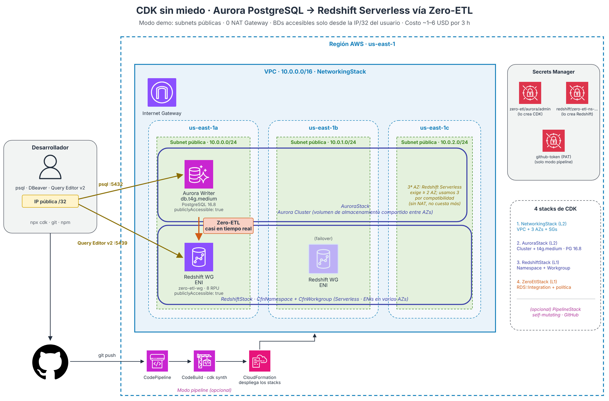

# Laboratorio: Aurora PostgreSQL → Redshift Serverless con Zero-ETL usando AWS CDK

🇬🇧 [Read it in English](LAB.en.md)

Esta guía te lleva de cero a tener Aurora PostgreSQL replicando datos en Redshift Serverless, casi en tiempo real, con un solo `npx cdk deploy`. Funciona en macOS, Linux y Windows (con WSL2). Cada paso termina con una verificación para que sepas que puedes seguir.

> 📖 ¿Quieres entender primero los conceptos (Zero-ETL, constructs L1/L2/L3, las trampas del código)? Lee el artículo **["CDK sin miedo" en Medium](https://medium.com/@carlosgaonad/cdk-sin-miedo-de-aurora-postgresql-a-redshift-serverless-con-zero-etl-e9d8cea17806)**.



| | |
|---|---|
| Tiempo | 1,5 a 2 horas (el despliegue tarda unos 15–20 min) |
| Costo estimado | Entre 1 y 6 USD si lo borras el mismo día |
| Sistemas operativos | macOS, Linux o Windows (con WSL2) |
| Nivel | 200 (intermedio): sabes programar y usar una terminal |

## Contenido

- [Antes de empezar: tu cuenta y los costos](#antes-de-empezar-tu-cuenta-y-los-costos)
- [Paso 0: elige tu terminal](#paso-0-elige-tu-terminal)
- [Paso 1: instala las herramientas](#paso-1-instala-las-herramientas)
- [Paso 2: conecta la terminal con tu cuenta de AWS](#paso-2-conecta-la-terminal-con-tu-cuenta-de-aws)
- [Paso 3: clona el proyecto e instala dependencias](#paso-3-clona-el-proyecto-e-instala-dependencias)
- [Paso 4: prueba y sintetiza (sin tocar tu cuenta)](#paso-4-prueba-y-sintetiza-sin-tocar-tu-cuenta)
- [Paso 5: prepara tu cuenta para CDK (bootstrap)](#paso-5-prepara-tu-cuenta-para-cdk-bootstrap)
- [Paso 6: guarda tu IP pública](#paso-6-guarda-tu-ip-pública)
- [Paso 7: revisa y despliega](#paso-7-revisa-y-despliega)
- [Paso 8: confirma que la integración está activa](#paso-8-confirma-que-la-integración-está-activa)
- [Paso 9: crea tablas y datos en Aurora](#paso-9-crea-tablas-y-datos-en-aurora)
- [Paso 10: activa la integración en Redshift](#paso-10-activa-la-integración-en-redshift)
- [Paso 11: consulta y prueba la replicación en vivo](#paso-11-consulta-y-prueba-la-replicación-en-vivo)
- [Paso 12 (opcional): ¿cómo sería en producción?](#paso-12-opcional-cómo-sería-en-producción)
- [Limpieza: borra todo al terminar](#limpieza-borra-todo-al-terminar)
- [Problemas comunes](#problemas-comunes)
- [Bonus: despliegue automático con cada `git push`](#bonus-despliegue-automático-con-cada-git-push)

---

## Antes de empezar: tu cuenta y los costos

Aurora y Redshift **no están en la capa gratuita** y cobran desde el primer minuto. El laboratorio es barato si lo borras el mismo día, pero conviene saber cuánto y protegerse.

### Tu cuenta de AWS necesita el plan "Paid"

Desde julio de 2025, las cuentas nuevas eligen entre un plan **Free** y un plan **Paid**. El plan Free solo da acceso a algunos servicios y **no incluye Redshift**: si lo intentas, verás un error como `SubscriptionRequiredException`.

- Si tu cuenta está en plan Free, actualízala a Paid desde la consola. Los créditos de bienvenida que no hayas usado se conservan.
- Si nunca has usado Redshift Serverless, puedes ser elegible para un [crédito de prueba de 300 USD](https://aws.amazon.com/redshift/free-trial/) válido por 90 días.
- No uses el usuario *root* para el laboratorio. En el paso 2 creamos un usuario solo para esto.

### Cuánto cuesta

Precios aproximados en `us-east-1`; confirma los de tu región en las páginas de precios de [Aurora](https://aws.amazon.com/rds/aurora/pricing/) y [Redshift](https://aws.amazon.com/redshift/pricing/).

| Recurso | Precio | Lab de 3 horas |
|---|---|---|
| Aurora `db.t4g.medium` (1 instancia) | ~0,073 USD/hora | ~0,22 USD |
| Almacenamiento e I/O de Aurora | Centavos para estos datos | < 0,05 USD |
| Redshift Serverless (8 RPU base) | 0,375 USD por RPU-hora = 3 USD por hora **activa** | 0,50 a 5 USD |
| Secrets Manager (2 secretos) | 0,40 USD/mes cada uno, prorrateado | < 0,01 USD |
| VPC, subnets, internet gateway | Gratis | 0 USD |
| NAT Gateway | No se crea en modo demo | 0 USD |

**Total estimado: entre 1 y 6 USD**, según cuánto trabaje Redshift. Redshift cobra por segundo (mínimo 60 segundos) cuando ejecuta tus consultas **y también cuando procesa los cambios que llegan por Zero-ETL**, así que con la integración activa no queda en cero.

> ⚠️ Si olvidas borrar todo, la cuenta sigue corriendo: Aurora sola suma ~1,75 USD por día, más el cómputo de Redshift. Por eso la [limpieza](#limpieza-borra-todo-al-terminar) es parte del laboratorio, no un extra.

### Crea una alerta de presupuesto (5 minutos)

1. En la consola, busca **Billing and Cost Management → Budgets → Create budget**.
2. Elige la plantilla **Monthly cost budget**.
3. Pon un monto, por ejemplo **10 USD**, y tu correo.
4. Crea el presupuesto. AWS te avisará si el gasto real o proyectado lo supera.

### Región

El lab está pensado para **us-east-1 (N. Virginia)**. Zero-ETL de Aurora PostgreSQL está disponible en todas las regiones comerciales donde existe Redshift, así que puedes usar otra; solo cambia la región en el paso 2 y en los comandos de limpieza.

---

## Paso 0: elige tu terminal

- **macOS:** la app Terminal.
- **Linux:** tu terminal habitual. Los comandos asumen Ubuntu/Debian.
- **Windows:** usa **WSL2** con Ubuntu. Todos los comandos del lab son de Bash y así funcionan igual que en Linux. Abre PowerShell como administrador, ejecuta lo siguiente y reinicia:

```powershell
wsl --install
```

Después del reinicio, abre la app **Ubuntu** y crea tu usuario. Desde aquí, sigue las instrucciones de Linux dentro de esa ventana.

## Paso 1: instala las herramientas

Necesitas cuatro cosas: **Node.js**, **Git**, **AWS CLI v2** y un **cliente de PostgreSQL** (`psql`). `jq` es opcional, pero ayuda a leer JSON.

**Node.js:** instala la versión LTS **22**. Es la que soporta la versión de CDK fijada en el proyecto. Con versiones más nuevas (por ejemplo, 25) el lab funciona, pero cada comando muestra un recuadro de advertencia `This software has not been tested with node`. La forma más sencilla es [nvm](https://github.com/nvm-sh/nvm): `nvm install 22 && nvm use 22`. El repo incluye un archivo `.nvmrc`, así que dentro de la carpeta basta con `nvm use`. También puedes usar el instalador de [nodejs.org/en/download](https://nodejs.org/en/download), eligiendo la versión 22.

**macOS** (con [Homebrew](https://brew.sh)):

```bash
brew install git awscli libpq jq
brew link --force libpq   # deja disponible el comando psql
```

**Linux / WSL2 (Ubuntu):**

```bash
sudo apt update && sudo apt install -y git unzip jq postgresql-client

# AWS CLI v2 (instalador oficial; en equipos ARM cambia x86_64 por aarch64)
curl "https://awscli.amazonaws.com/awscli-exe-linux-x86_64.zip" -o awscliv2.zip
unzip -q awscliv2.zip && sudo ./aws/install && rm -rf aws awscliv2.zip
```

> ¿Prefieres una interfaz gráfica en vez de `psql`? [DBeaver Community](https://dbeaver.io) es gratis y funciona en los tres sistemas. Te dejo la alternativa en el paso 9.

**Verificación:**

```bash
node --version   # v22.x
git --version
aws --version    # aws-cli/2.x
psql --version
```

## Paso 2: conecta la terminal con tu cuenta de AWS

Vamos a crear un usuario solo para el laboratorio y a darle llaves de acceso. Al terminar el lab, borras las llaves.

1. En la consola de AWS, entra a **IAM → Users → Create user**.
2. Nombre: `cdk-lab`. No necesita acceso a la consola.
3. En permisos, elige **Attach policies directly** y marca `AdministratorAccess`. (Es amplio, pero CDK crea roles, redes y bases de datos. Úsalo solo para este lab.)
4. Abre el usuario creado → pestaña **Security credentials** → **Create access key** → opción **Command Line Interface (CLI)**.
5. Copia el *Access key ID* y el *Secret access key*. El secreto solo se muestra una vez.

Luego, en tu terminal:

```bash
aws configure
# AWS Access Key ID:     <pega el Access key ID>
# AWS Secret Access Key: <pega el Secret access key>
# Default region name:   us-east-1
# Default output format: json
```

Si tu organización usa IAM Identity Center (SSO), usa `aws configure sso` en lugar de llaves.

**Verificación:**

```bash
aws sts get-caller-identity
```

Debes ver tu número de cuenta (`Account`) y el ARN del usuario `cdk-lab`.

## Paso 3: clona el proyecto e instala dependencias

```bash
git clone https://github.com/carlosgaonad/cdk-zero-etl-pipeline.git
cd cdk-zero-etl-pipeline
nvm use        # si usas nvm: toma la versión de .nvmrc
npm ci
```

`npm ci` instala exactamente las versiones de `package-lock.json`, incluida la de CDK. Si ves avisos de paquetes *deprecated*, puedes ignorarlos.

**Verificación:**

```bash
npx cdk --version   # 2.170.0
```

> Usa siempre `npx cdk` (no `cdk` global) para trabajar con la versión de CDK fijada en el proyecto.

## Paso 4: prueba y sintetiza (sin tocar tu cuenta)

Antes de crear nada en AWS, corre los tests y genera las plantillas:

```bash
npm test
npx cdk ls
```

Debes ver `Tests: 25 passed` y los cuatro stacks:

```text
CdkZeroEtl/NetworkingStack (CdkZeroEtl-NetworkingStack)
CdkZeroEtl/AuroraStack (CdkZeroEtl-AuroraStack)
CdkZeroEtl/RedshiftStack (CdkZeroEtl-RedshiftStack)
CdkZeroEtl/ZeroEtlStack (CdkZeroEtl-ZeroEtlStack)
```

Ahora mira lo que CDK va a pedirle a CloudFormation:

```bash
npx cdk synth CdkZeroEtl/AuroraStack
ls cdk.out/assembly-CdkZeroEtl/
```

Abre cualquier `*.template.json` en tu editor y busca `rds.logical_replication`. Ese JSON es lo que antes había que escribir a mano.

> Si ves `current credentials could not be used to assume '...cdk-hnb659fds-lookup-role...'. Proceeding anyway`, es normal antes del bootstrap: ese rol lo crea el paso 5.

## Paso 5: prepara tu cuenta para CDK (bootstrap)

Solo se hace una vez por cuenta y región:

```bash
npx cdk bootstrap
```

Tarda 2–3 minutos y termina con `Environment aws://<tu-cuenta>/us-east-1 bootstrapped`.

## Paso 6: guarda tu IP pública

Los security groups solo dejarán entrar conexiones desde tu IP:

```bash
export MY_IP="$(curl -s https://checkip.amazonaws.com)/32"
echo $MY_IP   # ejemplo: 190.25.10.4/32
```

> Si cierras la terminal, vuelve a ejecutar el `export`. Si tu IP cambia (otra red Wi-Fi, VPN), repite este paso y el paso 7.

Si trabajas en PowerShell nativo y no en WSL2, el equivalente es:

```powershell
$env:MY_IP = "$((Invoke-RestMethod https://checkip.amazonaws.com).Trim())/32"
```

## Paso 7: revisa y despliega

Primero, mira qué se va a crear:

```bash
npx cdk diff --all -c myIp=$MY_IP
```

Verás una lista de recursos con `[+]` y una tabla de cambios de seguridad (roles IAM y reglas de red). Revisarla antes de desplegar es un buen hábito.

Ahora despliega los cuatro stacks:

```bash
npx cdk deploy --all -c myIp=$MY_IP --require-approval never
```

`--require-approval never` evita que CDK te pregunte "¿deseas continuar?" en cada stack con cambios de seguridad; ya los revisaste con `diff`.

Tarda **15 a 20 minutos**; Aurora es la parte más lenta. Mientras tanto, abre **CloudFormation** en la consola y mira cómo aparecen los stacks `CdkZeroEtl-*` y sus recursos.

**Verificación:** la terminal termina con un ✅ por cada stack y muestra los *Outputs*, como `ClusterEndpoint`, `WorkgroupEndpoint` e `IntegrationArn`.

## Paso 8: confirma que la integración está activa

```bash
aws rds describe-integrations \
  --query "Integrations[].[IntegrationName,Status]" --output table
```

Espera a que el estado sea `active`. Puede pasar por `creating` unos minutos después de que termine el deploy.

## Paso 9: crea tablas y datos en Aurora

CDK guardó las credenciales de Aurora en Secrets Manager. Las leemos y las cargamos en las variables que usa `psql`:

```bash
SECRET=$(aws secretsmanager get-secret-value \
  --secret-id zero-etl/aurora/admin --query SecretString --output text)

export PGHOST=$(echo "$SECRET" | jq -r .host)
export PGUSER=$(echo "$SECRET" | jq -r .username)
export PGPASSWORD=$(echo "$SECRET" | jq -r .password)
export PGDATABASE=demodb

psql -c "SELECT version();"   # prueba de conexión
```

Si responde con `PostgreSQL 16.8`, ya estás dentro. Ahora ejecuta el script que crea un mini e-commerce (clientes, productos, pedidos):

```bash
psql -f sql/01-aurora-source.sql
```

**Verificación:** al final verás el conteo de filas: 5 `customers`, 5 `products`, 5 `orders` y 8 `order_items`.

> **Con DBeaver:** en la consola abre **Secrets Manager → `zero-etl/aurora/admin` → Retrieve secret value**. Crea una conexión PostgreSQL con ese `host`, puerto 5432, base `demodb`, `username` y `password`, y ejecuta el contenido de `sql/01-aurora-source.sql`.

Fíjate en un detalle del script: **todas las tablas tienen `PRIMARY KEY`**. Zero-ETL no replica tablas sin llave primaria.

## Paso 10: activa la integración en Redshift

Este es el único paso que no se puede automatizar con CloudFormation: crear en Redshift la base de datos que recibe la réplica.

Primero, obtén la contraseña del administrador de Redshift, que el propio servicio guardó en Secrets Manager:

```bash
RS_SECRET=$(aws secretsmanager list-secrets \
  --query "SecretList[?starts_with(Name,'redshift!zero-etl-ns')].Name | [0]" --output text)

aws secretsmanager get-secret-value --secret-id "$RS_SECRET" \
  --query SecretString --output text | jq -r .password
```

Luego, en la consola:

1. Abre **Amazon Redshift → Query editor v2**.
2. La primera vez te pide **Configure account**. Deja la encriptación por defecto, deja vacío el bucket de S3 y confirma.
3. En el panel izquierdo, haz clic en **Serverless: zero-etl-wg**.
4. Elige **Database user name and password**. Base de datos: `dev`, usuario: `rsadmin`, contraseña: la que obtuviste arriba. (También puedes elegir **AWS Secrets Manager** y seleccionar el secreto `redshift!zero-etl-ns…`.)

En una pestaña de consultas, busca el ID de la integración:

```sql
SELECT integration_id, source, state FROM svv_integration;
```

Copia el `integration_id` y úsalo aquí (el nombre `demodb` debe coincidir con la base de Aurora):

```sql
CREATE DATABASE aurora_data FROM INTEGRATION '<INTEGRATION_ID>' DATABASE demodb;
```

Espera uno o dos minutos y revisa el estado de cada tabla:

```sql
SELECT table_name, table_state
FROM svv_integration_table_state;
```

**Verificación:** las cuatro tablas aparecen en estado `Synced`.

## Paso 11: consulta y prueba la replicación en vivo

Una consulta analítica sobre los datos que llegaron desde Aurora:

```sql
SELECT c.country,
       COUNT(DISTINCT o.order_id)  AS pedidos,
       SUM(o.total_cents) / 100.0  AS ventas
FROM   aurora_data.public.orders    o
JOIN   aurora_data.public.customers c USING (customer_id)
WHERE  o.status IN ('paid', 'shipped')
GROUP  BY c.country
ORDER  BY ventas DESC;
```

Ahora el momento que hace que todo valga la pena. En tu terminal, inserta un cliente nuevo **en Aurora**:

```bash
psql -c "INSERT INTO customers (email, full_name, country) VALUES ('demo-en-vivo@example.com', 'Demo Live', 'CO');"
```

Espera unos segundos y consulta **en Redshift**:

```sql
SELECT customer_id, email, full_name, created_at
FROM   aurora_data.public.customers
WHERE  email LIKE 'demo-en-vivo%';
```

El cliente aparece sin que hayas escrito una sola línea de ETL. Prueba también un `UPDATE` o un `DELETE` en Aurora y mira cómo se reflejan.

Para confirmar que la réplica es de solo lectura, intenta esto en Redshift; debe fallar:

```sql
INSERT INTO aurora_data.public.customers (email, full_name, country)
VALUES ('no@example.com', 'No', 'CO');
```

El script `sql/02-redshift-target.sql` trae más consultas de ejemplo (productos más vendidos, cómo materializar tus propias tablas en otra base).

## Paso 12 (opcional): ¿cómo sería en producción?

Este comando **no despliega nada**. Solo te muestra qué cambiaría si pasaras a la red de producción:

```bash
npx cdk diff --all -c demoMode=false
```

Verás aparecer subnets privadas y aisladas, NAT Gateways y bases de datos sin acceso público. Es la misma arquitectura con otra postura de seguridad, y la diferencia es un booleano.

---

## Limpieza: borra todo al terminar

Haz estos pasos el mismo día, en este orden. Toman unos 15 minutos y evitan cobros inesperados.

**1. Borra la base de la integración en Redshift** (en Query editor v2):

```sql
DROP DATABASE aurora_data;
```

Si te saltas este paso, el borrado del `ZeroEtlStack` puede fallar.

**2. Destruye los stacks:**

```bash
npx cdk destroy --all --force
```

CDK los borra en orden inverso: Zero-ETL → Redshift y Aurora → red. Tarda 10–15 minutos.

**3. Borra de inmediato el secreto de Aurora:**

```bash
aws secretsmanager delete-secret --secret-id zero-etl/aurora/admin \
  --force-delete-without-recovery --region us-east-1
```

CloudFormation programa el borrado del secreto con un periodo de recuperación. Mientras tanto, el nombre sigue ocupado y un segundo despliegue fallaría. Este comando lo libera ya.

**4. Verifica que no quede nada:**

```bash
aws cloudformation list-stacks --stack-status-filter CREATE_COMPLETE UPDATE_COMPLETE \
  --query "StackSummaries[?contains(StackName,'CdkZeroEtl')].StackName" --output table
aws rds describe-db-clusters --query "DBClusters[].DBClusterIdentifier" --output table
aws redshift-serverless list-workgroups --query "workgroups[].workgroupName" --output table
```

Las tres respuestas deben estar vacías.

**5. Revoca el acceso del laboratorio:** en **IAM → Users → cdk-lab**, desactiva y borra la llave de acceso, o borra el usuario completo.

**6. Opcional:** el stack `CDKToolkit` del bootstrap cuesta centavos al mes. Si no vas a usar CDK en esta cuenta, bórralo desde CloudFormation y luego vacía y borra su bucket `cdk-…-assets-…` en S3.

Al día siguiente, revisa **Billing → Bills** para confirmar que el gasto se detuvo.

---

## Problemas comunes

| Síntoma | Causa probable | Solución |
|---|---|---|
| `Cannot find version 16.4 for aurora-postgresql` | Tienes una copia vieja del repo | `git pull` para obtener la versión con Aurora 16.8 |
| `SubscriptionRequiredException` al abrir Redshift | Tu cuenta está en el plan Free | Actualiza la cuenta al plan Paid |
| `Unable to resolve AWS account to use` | La terminal no tiene credenciales o tu sesión SSO expiró | Repite el paso 2 o ejecuta `aws sso login` |
| `This stack uses assets, so the toolkit stack must be deployed` | Falta el bootstrap | Ejecuta el paso 5 |
| Recuadro `This software has not been tested with node` | Usas una versión de Node distinta de la 22 | `nvm install 22 && nvm use` |
| `psql` se queda esperando hasta dar timeout | Tu IP cambió o no pasaste `-c myIp` | Repite los pasos 6 y 7; solo se actualizan los security groups |
| `$(...)` no se reconoce | Estás en PowerShell, no en Bash | Usa WSL2 o la variante de PowerShell del paso 6 |
| La integración queda en `failed` | Falta un parámetro en Aurora o Redshift, o la política | El repo ya los configura; revisa que no los hayas cambiado |
| Una tabla no aparece en Redshift | La tabla no tiene `PRIMARY KEY` | Agrégala en Aurora |
| `CREATE DATABASE ... FROM INTEGRATION` falla | La integración aún no está `active` | Espera y repite el paso 8 |
| `cdk destroy` falla en `ZeroEtlStack` | Existe la base `aurora_data` en Redshift | Ejecuta el `DROP DATABASE` y vuelve a destruir |
| Un segundo deploy falla por el secreto de Aurora | El secreto anterior sigue programado para borrarse | Ejecuta el paso 3 de la limpieza |

---

## Bonus: despliegue automático con cada `git push`

El repo incluye un modo opcional: un **pipeline de CDK** que se actualiza a sí mismo (*self-mutating*). Despliegas el pipeline una vez y, desde ahí, cada `git push` a `main` vuelve a sintetizar y desplegar los cuatro stacks. Haz primero el laboratorio en modo directo; este bonus es para cuando ya lo entiendas.

```text
git push ─▶ Source (GitHub) ─▶ Synth (npm ci + cdk synth) ─▶ SelfMutate ─▶ Deploy
                                                                        │
                          Red → Aurora + Redshift → [aprobación manual] → Zero-ETL
```

La aprobación manual antes de Zero-ETL te da tiempo de cargar los datos en Aurora (paso 9) antes de crear la integración.

1. Haz un *fork* del repo en tu cuenta de GitHub y clónalo.
2. En `cdk.json`, cambia `"githubOwner": "carlosgaonad"` por tu usuario de GitHub, y haz commit y push.
3. En GitHub, crea un token clásico en **Settings → Developer settings → Personal access tokens → Tokens (classic)** con los permisos `repo` y `admin:repo_hook`.
4. Guárdalo en Secrets Manager con el nombre que espera el código:

   ```bash
   aws secretsmanager create-secret --name github-token \
     --secret-string "ghp_TU_TOKEN" --region us-east-1
   ```

5. Despliega solo el pipeline:

   ```bash
   npx cdk deploy CdkZeroEtl-Pipeline -c usePipeline=true -c myIp=$MY_IP --require-approval never
   ```

6. En la consola, abre **CodePipeline → ZeroEtlPipeline** y mira la ejecución. Cuando llegue a **Approve-ZeroETL-Integration**, carga los datos en Aurora y aprueba.

**Limpieza en modo pipeline:** borrar el pipeline **no** borra los stacks que desplegó. Ejecuta `DROP DATABASE aurora_data;` en Redshift y luego borra, en este orden, `Deploy-ZeroEtlStack`, `Deploy-RedshiftStack`, `Deploy-AuroraStack` y `Deploy-NetworkingStack` desde CloudFormation. Después borra el stack `CdkZeroEtl-Pipeline` y los secretos `github-token` y `zero-etl/aurora/admin`.
