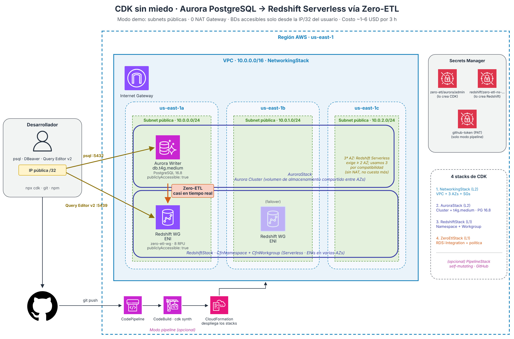

# cdk-zero-etl-pipeline

**CDK sin miedo**: integración Zero-ETL entre **Aurora PostgreSQL** y **Amazon Redshift Serverless**, desplegada con AWS CDK (TypeScript) y un CodePipeline self-mutating opcional.

> 🇬🇧 **English:** CDK project that deploys an Aurora PostgreSQL → Redshift Serverless Zero-ETL integration. Follow the step-by-step lab in **[LAB.en.md](LAB.en.md)**.



## 👉 Empieza aquí

| | Español | English |
|---|---|---|
| Laboratorio paso a paso (macOS, Linux y Windows) | **[LAB.md](LAB.md)** | **[LAB.en.md](LAB.en.md)** |
| Artículo con los conceptos (Medium) | **[CDK sin miedo](https://medium.com/@carlosgaonad/cdk-sin-miedo-de-aurora-postgresql-a-redshift-serverless-con-zero-etl-e9d8cea17806)** | 🚧 En construcción / Coming soon |

El laboratorio explica desde la creación de la cuenta y la instalación de herramientas hasta la limpieza final, con una verificación al terminar cada paso. El resto de este README es una referencia rápida para quien ya conoce CDK.

> **💰 Costo estimado del laboratorio**
> Una sesión de 2-3 horas + destruir al terminar: **entre 1 y 6 USD**.
> Aurora `db.t4g.medium` cuesta ~$0.073/hr y Redshift Serverless cobra por segundo mientras ejecuta queries **y mientras procesa los cambios que llegan por Zero-ETL**. No hay NAT Gateway en modo demo. Detalles en [Costos](#costos).

> **📋 Requisitos de la cuenta**
> Redshift no está disponible en el plan **Free** de las cuentas nuevas de AWS: necesitas el plan **Paid**. Si nunca has usado Redshift Serverless, puedes ser elegible para el [crédito de prueba de $300](https://aws.amazon.com/redshift/free-trial/).

---

## Qué construye

Cuatro stacks orquestados en un `cdk.Stage`:

1. **NetworkingStack** — VPC, subnets, security groups (L2 puro)
2. **AuroraStack** — Aurora PostgreSQL 16.8 (LTS) provisioned, cluster con 1 sola instance `db.t4g.medium` (L2)
3. **RedshiftStack** — Namespace + Workgroup de Redshift Serverless (L1)
4. **ZeroEtlStack** — Resource policy + `rds.CfnIntegration` con `dataFilter: 'include: demodb.public.*'` (L1)

Opcionalmente:

5. **PipelineStack** — CodePipeline self-mutating con `ManualApprovalStep` antes de desplegar `ZeroEtlStack`; se autodespliega en cada `git push`

---

## Por qué esta configuración

| Decisión | Razón |
|---|---|
| **Aurora PostgreSQL 16.8 (LTS)** | Zero-ETL requiere 16.4+; la 16.4 ya salió del soporte estándar. 16.8 es LTS, con soporte hasta feb-2029 |
| **Aurora provisioned** (no Serverless v2) | Más predecible y barato para una demo corta. Serverless v2 mínimo es 0.5 ACU = $0.06/hr; t4g.medium = $0.073/hr pero sin sorpresas de auto-scaling |
| **db.t4g.medium** | La instance class **más pequeña permitida** en Aurora PG. Aurora no soporta t3.small ni t4g.small |
| **Sin readers** | 1 sola writer ahorra otro $0.073/hr |
| **1 cluster, no Serverless v2** | Zero-ETL fuerza logical replication, lo que impide el auto-pause de Serverless v2 — así que el "scale to zero" no aplica de todos modos |
| **Redshift Serverless** | Cobra por segundo (mínimo 60 s) solo cuando hay trabajo: tus queries y el procesamiento de la replicación Zero-ETL |
| **3 AZs en la VPC** | Redshift Serverless requiere subnets en mínimo 2 AZs (sin EVR) desde julio 2025. Usamos 3 para máxima compatibilidad regional; en modo demo no hay NAT, así que la 3a AZ no cuesta nada |
| **public subnets en demo** | 0 NAT Gateways = ahorras $32/mes por NAT |

---

## Costos

| Recurso | Precio | Demo 3h |
|---|---|---|
| Aurora `db.t4g.medium` (1 writer) | $0.073/hr | $0.22 |
| Aurora storage (Standard, prorrateado) | $0.10/GB-mes | <$0.05 |
| Redshift Serverless (8 RPU base) | $0.375 por RPU-hr = $3/hr mientras está activo | $0.50-5 (queries + replicación) |
| NAT Gateway (modo demo) | $0 | $0 |
| Secrets Manager (2 secrets) | $0.40/mes c/u prorrateado | <$0.01 |
| VPC, subnets, IGW | Gratis | $0 |
| **Total demo 3h + destruir** | | **~$1-6 USD** |

> Si dejas todo encendido **24 horas seguidas** sin destruir: Aurora sola suma ~$1.75/día, más el cómputo de Redshift.
> Por eso es **crítico** ejecutar `cdk destroy --all --force` al terminar.

---

## Estructura del proyecto

```
cdk-zero-etl-pipeline/
├── bin/
│   └── app.ts                       # Entry point con switch demo/pipeline
├── lib/
│   ├── pipeline-stack.ts            # CodePipeline opcional
│   ├── stages/
│   │   └── deploy-stage.ts          # Stage que agrupa los 4 stacks
│   └── stacks/
│       ├── networking-stack.ts      # VPC + SGs (flag demoMode)
│       ├── aurora-stack.ts          # Aurora PostgreSQL t4g.medium
│       ├── redshift-stack.ts        # Redshift Serverless (L1)
│       └── zero-etl-stack.ts        # CfnIntegration + resource policy
├── sql/
│   ├── 01-aurora-source.sql         # Schema + datos en Aurora
│   └── 02-redshift-target.sql       # CREATE DATABASE FROM INTEGRATION
├── test/
│   └── stacks.test.ts               # 25 tests unitarios
├── cdk.json
├── jest.config.js
├── package.json
├── tsconfig.json
├── docs/images/                     # Diagramas de arquitectura (ES / EN)
├── LAB.md                           # Laboratorio paso a paso (español)
├── LAB.en.md                        # Step-by-step lab (English)
└── README.md                        # Este archivo
```

---

## Modos de despliegue

Dos modos controlados por flags de contexto CDK:

| Flag | Default | Qué hace |
|---|---|---|
| `demoMode` | `true` | Public subnets, 0 NAT, DBs accesibles por tu IP/32 |
| `usePipeline` | `false` | `true` despliega un CodePipeline self-mutating |
| `myIp` | (vacío) | IP/32 desde donde te conectas (solo demo) |

Combinaciones:

```bash
# Demo más simple (deploy directo)
npx cdk deploy --all -c myIp=$(curl -s ifconfig.me)/32

# Demo con pipeline (ver sección Pipeline más abajo)
npx cdk deploy CdkZeroEtl-Pipeline -c usePipeline=true -c myIp=$MY_IP --require-approval never

# Producción
npx cdk deploy --all -c demoMode=false
```

---

## Prerequisitos

| Herramienta | Versión |
|---|---|
| Node.js | 22.x LTS (la versión que soporta el CDK fijado en el proyecto; con `nvm` basta `nvm use`, gracias a `.nvmrc`) |
| AWS CLI | v2, con credenciales configuradas (`aws sts get-caller-identity` debe funcionar) |
| Git | cualquiera reciente |
| psql (cliente PostgreSQL) | cualquiera reciente, o DBeaver como alternativa gráfica |

En Windows, usa **WSL2** (Ubuntu): todos los comandos de este README son de Bash.

Usa siempre `npx cdk` (no `cdk` global) para trabajar con la versión de CDK fijada en `package-lock.json`.

---

## Quick start

> ¿Primera vez con CDK o con AWS? Sigue el [laboratorio completo](LAB.md) en lugar de este resumen.

### Deploy directo (demo local)

```bash
npm ci
npm test                                          # 25 tests
npx cdk bootstrap aws://TU_ACCOUNT/us-east-1      # una sola vez
export MY_IP="$(curl -s https://checkip.amazonaws.com)/32"
npx cdk deploy --all -c myIp=$MY_IP --require-approval never
```

**Tiempo de deploy:** ~12-15 min (Aurora provisioned tarda ~8 min, más rápido que Serverless v2).

Después del deploy, en el Redshift Query Editor v2:

```sql
SELECT integration_id FROM svv_integration;
CREATE DATABASE aurora_data FROM INTEGRATION '<id>' DATABASE demodb;
```

### Deploy con Pipeline (self-mutating)

```bash
# 1. Crear PAT en GitHub: Settings → Developer settings → Personal access tokens
#    Scopes: repo, admin:repo_hook

# 2. Guardarlo en Secrets Manager
aws secretsmanager create-secret \
  --name github-token \
  --secret-string "ghp_TU_TOKEN" \
  --region us-east-1

# 3. Haz fork del repo y cambia "githubOwner" en cdk.json por tu usuario
#    (el valor de cdk.json tiene prioridad sobre las variables de entorno).
#    Haz commit y push de ese cambio antes de desplegar el pipeline.

# 4. Deploy SOLO el PipelineStack
npx cdk deploy CdkZeroEtl-Pipeline \
  -c usePipeline=true \
  -c myIp=$MY_IP \
  --require-approval never
```

> **Limpieza en modo pipeline:** borrar `CdkZeroEtl-Pipeline` NO borra los stacks que desplegó. Primero `DROP DATABASE aurora_data;` en Redshift y luego borra en CloudFormation, en orden: `Deploy-ZeroEtlStack`, `Deploy-RedshiftStack`, `Deploy-AuroraStack`, `Deploy-NetworkingStack`. Al final, el stack del pipeline y el secret `github-token`.

> El pipeline tiene un paso de **aprobación manual** (`ManualApprovalStep`) antes de desplegar `ZeroEtlStack`. Tienes que poblar la DB Aurora con el script sql/01-aurora-source.sql usando la terminal. Aprueba el pipeline desde la consola de CodePipeline cuando quieras activar la integración Zero-ETL.


>Copia el ID de la integración de ZeroETL.
>Luego ve a Redshift Query EditorV2 y usa el script sql/02-redshift-target.sql para crear la DB usando la integración.
---

## Tests

```bash
npm test
```

| Stack | Qué valida |
|---|---|
| NetworkingStack (demo) | 1 VPC, 0 NAT, public subnets, SG con tu IP |
| NetworkingStack (prod) | 2 NAT, 3 capas de subnets |
| AuroraStack | Cluster PG, 1 instance, **db.t4g.medium**, enhanced_logical_replication, no es serverless |
| RedshiftStack | Namespace + workgroup, manageAdminPassword, case_sensitive |
| ZeroEtlStack | CfnIntegration, ARNs, Custom Resource, **acción IAM correcta**, dataFilter |
| PipelineStack | CodePipeline + CodeBuild + ManualApprovalStep |

---

## Eliminar todo al finalizar

> La guía completa, con verificación y el caso del modo pipeline, está en [LAB.md › Limpieza](LAB.md#limpieza-borra-todo-al-terminar).

```sql
-- En Redshift Query Editor v2
DROP DATABASE aurora_data;
```

```bash
npx cdk destroy --all --force
aws secretsmanager delete-secret --secret-id zero-etl/aurora/admin \
  --force-delete-without-recovery --region us-east-1
```

Verifica que no queda nada:

```bash
aws cloudformation list-stacks \
  --stack-status-filter CREATE_COMPLETE UPDATE_COMPLETE \
  --query 'StackSummaries[?contains(StackName, `CdkZeroEtl`)].StackName' \
  --output table

aws rds describe-db-clusters --query 'DBClusters[].DBClusterIdentifier' --output table
aws redshift-serverless list-workgroups --query 'workgroups[].workgroupName' --output table
```

---

## Licencia

MIT — ver [LICENSE](LICENSE).
